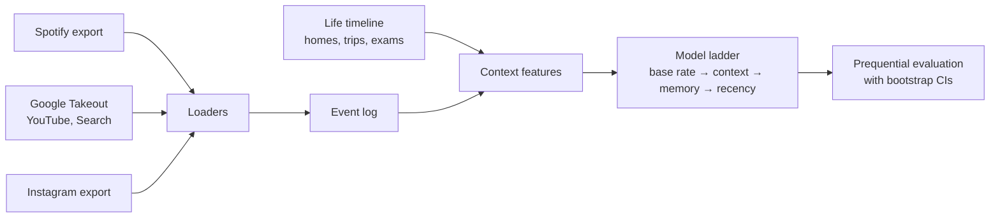

# Amber

A personal decision engine. It learns to predict the choices a person makes (skip this song, go back to this creator, "see more" or "not interested") from the data exports that Spotify, Google and Instagram are required to give them.

No quizzes, no surveys and no API keys. The only input is the person's own data.

## How it works



- **Loaders** parse exports from three platforms into one event log: Spotify (extended and account history), Google Takeout (HTML and JSON) and Instagram (three JSON layouts). Files are read from an allow-list, so messages, media, contacts and AI-chat logs are never opened.
- **Context** places every event in the person's real local time. Time zones come from a home timeline plus trips detected from country-specific Google Maps domains. Each event also gets a life phase and the distance to the next exam window.
- **Models** form a ladder. Each rung adds one kind of knowledge, so the gain between rungs measures what that knowledge is worth. The learner is online logistic regression written in numpy, with streaming standardization.
- **Evaluation** is prequential: each decision is predicted from strictly earlier data, then learned from. The last 20% of the timeline is held out, and 95% confidence intervals come from a block bootstrap by calendar day.

## Results

**Spotify skip prediction on synthetic users** (5,000 plays, about 970 held out; holdout log loss, lower is better):

| User | Base rate | + Context | + Memory | + Recency |
|---|---|---|---|---|
| With real habits | 0.670 | 0.650 | 0.562 | **0.526** |
| Skips at random (control) | 0.602 | 0.602 | 0.601 | 0.602 |

On the user with real habits, accuracy rises from 61% to 74%, and memory beats context by 0.088 log loss (95% CI 0.068 to 0.109). On the random user no rung beats the base rate, which is the point of the control. It caught two leaks during development, both fixed:
- Spotify timestamps a play when it ends, so a "time since the last play" feature contained the play's own length (the random user scored AUC 0.957).
- Spotify's listening time excludes pauses.

**First look at real data** (one person, about 69,000 events from 2020 to 2026). A single count from earlier activity already ranks the next decision well:

| Decision | Base rate | AUC |
|---|---|---|
| Like the same Instagram creator again within 7 days | 24% | 0.90 |
| Watch the same YouTube channel again within 7 days | 34% | 0.82 |
| Reels feedback: "see more" vs "not interested" | 89% | 0.73 |

These are exploratory: scored on all the data at once, not yet on the held-out protocol.

**Earlier experiment.** The first version of Amber tried to learn taste through a this-or-that quiz in a CLIP embedding space (art preferences predicting clothing picks). On a real run it scored 52.5%, no better than a coin flip, while a model of the person's own past picks reached 66%. That result is why the project switched from asking people questions to learning from decisions they had already made. Write-up: [docs/results/first-run.md](docs/results/first-run.md).

## Quickstart

```bash
uv sync

# synthetic data
uv run amber decide fake data/exports/fake --kind personal   # or --kind null
uv run amber decide eval data/exports/fake

# your own exports, in data/exports/{spotify,google,meta}/
uv run amber decide eval --tz America/Toronto    # Spotify skip ladder
uv run amber decide sources                      # Google + Instagram event log, prints counts only
```

`data/` is git-ignored. Raw exports and private reports stay on your machine. Published reports contain aggregates only, and publishing refuses to run on synthetic data.

## Code

```
src/amber/decide/
  spotify.py         Spotify loader: both formats, play-start timestamps, dedup
  google_html.py     Google Takeout HTML parser (regex, linear time)
  google_takeout.py  Takeout JSON and the shared URL classifier
  instagram.py       Instagram loader: three layouts, explicit feedback
  life.py            home and trip time zones, life phases, exam windows
  features.py        leak-free context, memory and decayed-memory features
  model.py           online logistic regression and the model ladder
  metrics.py         log loss, Brier, AUC, calibration, day-block bootstrap
  pipeline.py        export in, reports out
src/amber/           the earlier quiz app: CLIP space, preference models, FastAPI
web/                 its React front end
tests/               736 tests (pytest)
```

**Stack:** Python 3.12, numpy, pandas, PyTorch with open_clip, FastAPI, React and TypeScript, Typer, pytest, ruff, uv.

```bash
uv run pytest -q && uv run ruff check .
```
