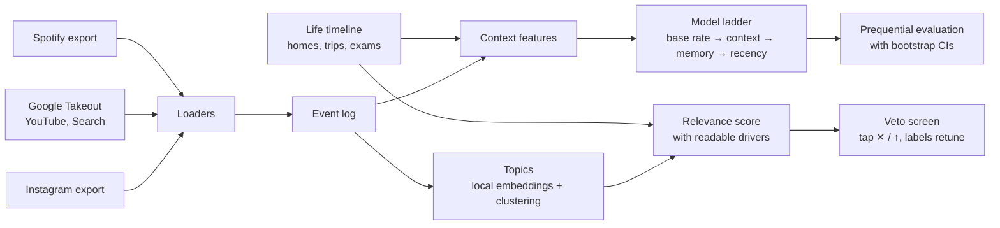

# Amber

A personal decision engine. It learns what a person cares about, and the choices they make, from the data exports that Spotify, Google and Instagram are required to give them.

It works on **topics**, not creators. Which creator someone engaged with says little about who they are. Whether they kept coming back to a subject for years, searched for it on purpose, and still do, says a lot.

No quizzes, no surveys and no API keys. The only input is the person's own data, and everything runs locally.

## How it works



- **Loaders** parse exports from three platforms into one event log: Spotify (extended and account history), Google Takeout (HTML and JSON) and Instagram (three JSON layouts). Files are read from an allow-list, so messages, media, contacts and AI-chat logs are never opened.
- **Context** places every event in the person's real local time. Time zones come from a home timeline plus trips detected from country-specific Google Maps domains. Each event also gets a life phase and the distance to the next exam window.
- **Models** form a ladder. Each rung adds one kind of knowledge, so the gain between rungs measures what that knowledge is worth. The learner is online logistic regression written in numpy, with streaming standardization.
- **Topics** come from YouTube titles, Google searches and Instagram captions, embedded with a small local sentence model (MiniLM, about 90 MB) and clustered with spherical k-means. Clusters are named from a fixed generic vocabulary, or by their c-TF-IDF keywords when no label fits.
- **Relevance** asks "how important is this to me". It's high when a topic lasts for months and years, shows up in deliberate actions (searching, liking, saving), appears on more than one platform and is still active. It's low when the topic is concentrated in exam windows, on one trip, in one burst or only long ago. Every feature compares the topic with the person's own baseline, so random topics score flat. Each score comes with its reasons ("steady for 4 years", "mostly during exams", "fading lately").
- **The veto screen** ranks the topics. Tapping ✕ (wrong) or ↑ (boost) stores a label, and the weights are refit as a MAP logistic regression centred on the frozen ones.
- **Evaluation** is prequential: each decision is predicted from strictly earlier data, then learned from. The last 20% of the timeline is held out, and 95% confidence intervals come from a block bootstrap by calendar day.

## Results

**Topics** (frozen as git tag `topics-v1` before the first real run; full write-up in [docs/results/topics-v1.md](docs/results/topics-v1.md)):

| User | Relevance spread across topics | Top topic |
|---|---|---|
| Topics random over time (null control, 3 seeds) | 0.06 to 0.10 | n/a |
| Planted: one steady, deliberate, cross-platform topic plus exam, trip, burst, long-ago and passive traps | 0.70 to 0.74 | the planted topic; every trap below the background median |
| One person's real exports: 49,912 documents in 41 topics | 0.01 to 0.61 | (private) |

On the real data, the topic the owner expected to score low ranks 27th of 41, driven by passive viewing rather than any rule. Chores (maps, weather and so on) all land in the bottom half. Running on real data also caught a bug: the burst detector assumed nanosecond timestamps, but real exports store microseconds, so every topic looked like a burst. It's fixed, and a test now covers every resolution.

**Spotify skip prediction on synthetic users** (5,000 plays, about 970 held out; holdout log loss, lower is better):

| User | Base rate | + Context | + Memory | + Recency |
|---|---|---|---|---|
| With real habits | 0.670 | 0.650 | 0.562 | **0.526** |
| Skips at random (control) | 0.602 | 0.602 | 0.601 | 0.602 |

On the user with real habits, accuracy rises from 61% to 74%, and memory beats context by 0.088 log loss (95% CI 0.068 to 0.109). On the random user no rung beats the base rate, which is the point of the control. It caught two leaks during development, both fixed:
- Spotify timestamps a play when it ends, so a "time since the last play" feature contained the play's own length (the random user scored AUC 0.957).
- Spotify's listening time excludes pauses.

**Creator return (plumbing check).** These tasks test the loaders and the evaluation, not the product: the engine no longer builds anything on which creators a person returns to. Data: one person's Google and Instagram exports, about 69,000 events from 2020 to 2026. The protocol was frozen as git tag `decide-v2` before the first run. Every decision is predicted from strictly earlier data, and a 7-day label only trains the model once its 7 days are over. Scores are on the last 20% of decisions (June to November 2026):

| Decision | Held out | Base rate | Context + life AUC | + Memory AUC | Memory's log-loss gain (95% CI) |
|---|---|---|---|---|---|
| Watch the same YouTube channel again within 7 days | 2,878 | 31% | 0.54 | **0.85** | +0.19 (+0.16 to +0.22) |
| Like the same Instagram creator again within 7 days | 1,949 | 29% | 0.57 | **0.94** | +0.37 (+0.31 to +0.44) |
| Reels feedback: "see more" vs "not interested" | 381 | 97% | 0.72 | 0.76 | no gain over the base rate |

- **Returning to a creator is predictable, but that's habit, not identity.** Time of day, weekends, exam weeks and travel add nothing here. A person's own history with a creator does almost all the work.
- **Reels feedback fails the headline rule.** 97% of recent feedback is "see more", so the base rate is already hard to beat with 381 examples.
- **The null control passes.** On a synthetic user whose creators are drawn at random, memory gains nothing. A prefix-invariance test checks that no prediction changes when future data is deleted.

Full tables: [docs/results/sources-v2.md](docs/results/sources-v2.md).

**Earlier experiment.** The first version of Amber tried to learn taste through a this-or-that quiz in a CLIP embedding space (art preferences predicting clothing picks). On a real run it scored 52.5%, no better than a coin flip, while a model of the person's own past picks reached 66%. That result is why the project switched from asking people questions to learning from decisions they had already made. Write-up: [docs/results/first-run.md](docs/results/first-run.md).

## Quickstart

```bash
uv sync

# synthetic data
uv run amber decide fake data/exports/fake --kind personal   # or --kind null
uv run amber decide eval data/exports/fake

# your own exports, in data/exports/{spotify,google,meta}/
uv run amber decide eval --tz America/Toronto    # Spotify skip ladder
uv run amber decide sources                      # Google + Instagram event log, prints counts only
uv run amber decide tasks                        # score the v2 decisions (aggregates only)
uv run amber topics build                        # topics + relevance, prints counts only
uv run amber serve                               # the veto screen at http://localhost:8000
```

`data/` is git-ignored. Raw exports and private reports stay on your machine. Published reports contain aggregates only, and publishing refuses to run on synthetic data.

## Code

```
src/amber/decide/
  spotify.py         Spotify loader: both formats, play-start timestamps, dedup
  google_html.py     Google Takeout HTML parser (regex, linear time)
  google_takeout.py  Takeout JSON and the shared URL classifier
  instagram.py       Instagram loader: three layouts, explicit feedback
  life.py            home and trip time zones, life phases, exam windows
  features.py        leak-free context, memory and decayed-memory features
  model.py           online logistic regression and the model ladder
  metrics.py         log loss, Brier, AUC, calibration, day-block bootstrap
  pipeline.py        export in, reports out
  tasks.py           v2 decisions: delayed labels, life rung, held-out scoring
src/amber/topics/
  docs.py            events to topic documents, deliberate actions weighted up
  embed.py           local MiniLM encoder, hashing fallback, embedding cache
  extract.py         spherical k-means, label naming, c-TF-IDF keywords
  relevance.py       frozen relevance features, score and drivers
  feedback.py        veto/boost labels and MAP retuning
src/amber/api/       FastAPI: the veto screen, and the earlier quiz app
web/                 React front end: veto screen at /, the earlier quiz at /#v0
tests/               784 tests (pytest)
```

**Stack:** Python 3.12, numpy, pandas, PyTorch with open_clip, FastAPI, React and TypeScript, Typer, pytest, ruff, uv.

```bash
uv run pytest -q && uv run ruff check .
```
